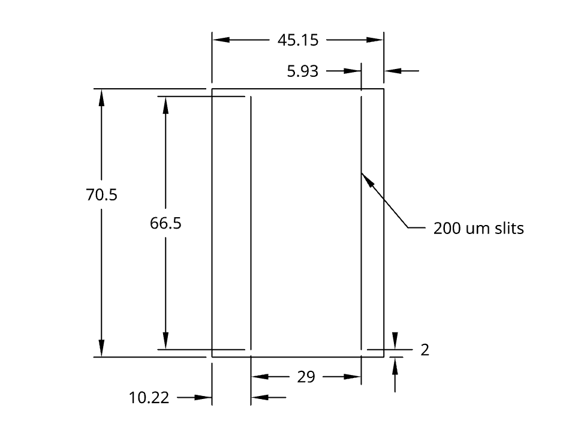
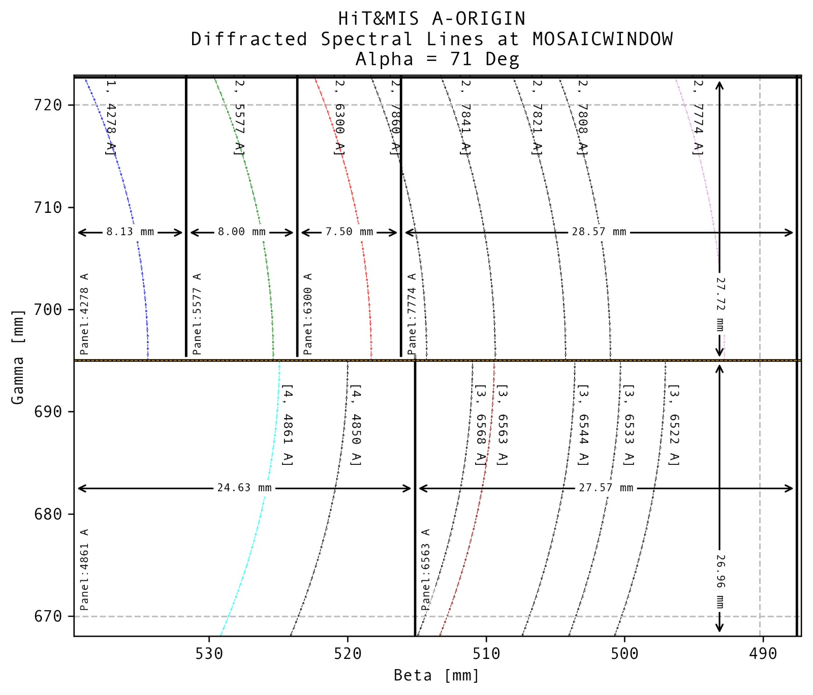

## General information
|            |                                                                                                                                                                                                                                                                                                                                                                                                                       |      |
| :--------- | :-------------------------------------------------------------------------------------------------------------------------------------------------------------------------------------------------------------------------------------------------------------------------------------------------------------------------------------------------------------------------------------------------------------------- | ---: |
| Instrument | [ HiT&MIS   High Throughput and Multislit Imaging spectrograph](https://www.google.com/url?sa=t&source=web&rct=j&opi=89978449&url=https://www.spiedigitallibrary.org/journals/optical-engineering/volume-51/issue-1/013003/High-throughput-and-multislit-imaging-spectrograph-for-extended-sources/10.1117/1.OE.51.1.013003.full&ved=2ahUKEwi2rc7HzNSSAxUgMlkFHQC5KTYQFnoECBkQAQ&usg=AOvVaw0c8dcivntp654GQ-gN7WAJ) |
| Location   | Swedish Institute of Space Physics  [IRF Sweden](https://www.irf.se/en/)                                                                                                                                                                                                                                                                                                                                           |
| Duration   | Start - Nov 15, 2025  End - Present                                                                                                                                                                                                                                                                                                                                                                           |
| File Type  | FITS files                                                                                                                                                                                                                                                                                                                                                                                                            |

## Optical Components of Hit&MIS
| Component         | Characteristics                                                                                                                                                                                                                                                                                                                                                                                                                                                         |      |
| :---------------- | :---------------------------------------------------------------------------------------------------------------------------------------------------------------------------------------------------------------------------------------------------------------------------------------------------------------------------------------------------------------------------------------------------------------------------------------------------------------------- | ---: |
| Fore Optics       | Type = Telecentric Lens ([pg. 16](https://umasslowell.idm.oclc.org/login?url=https://www.proquest.com/dissertations-theses/design-calibration-compact-multichannel-imaging/docview/2822152442/se-2?accountid=14575))  Diameter = 18 mm  F/# = 1.388   FOV ~45°   One for each Slit                                                                                                                                                                          |
| Entrance Slits    | 4 Slits  Width = 200 um  Height = 25 mm                                                                                                                                                                                                                                                                                                                                                                                                                           |
| Field Lens 1      | Type = Plano-convex  Size = 50 x 50 mm^2^  Focal Length = 500 mm                                                                                                                                                                                                                                                                                                                                                                                                  |
| Collimator/Camera | type = Achromat  Diameter = 100 mm  Focal Length = 400 mm                                                                                                                                                                                                                                                                                                                                                                                                         |
| Grating           | Size = 110 x 220 mm^2^  Ruled Area = 102 x 204 mm^2^  Ruling Density = 98.76 lines/mm  Blaze Angle = 65.5°  Incidence Angle = 71.1°                                                                                                                                                                                                                                                                                                                         |
| Field Lens 2      | Type = Plano-convex  Size = 50 x 50 mm^2^  Focal Length = 500 mm                                                                                                                                                                                                                                                                                                                                                                                                  |
| Field Lens 3      | Type = Plano-convex  Size = 50 x 50 mm^2^  Focal Length = 200 mm                                                                                                                                                                                                                                                                                                                                                                                                  |
| Collimator        | Type = Cooke Triplet  Diameter = 50 mm  Focal length = 210 mm                                                                                                                                                                                                                                                                                                                                                                                                     |
| Camera Lens       | diameter = 50 mm  F/# = 0.95                                                                                                                                                                                                                                                                                                                                                                                                                                         |
| Detector          | [ZWO ASI 533 MC Pro](https://www.highpointscientific.com/zwo-asi533mc-pro-usb3-cooled-color-camera-asi533mc-p?utm_campaign=&utm_content=&utm_source=google&utm_medium=cpc&utm_term=ZWO-ASI533MC-P&utm_source=google&utm_medium=cpc&utm_campaign=20618277309&utm_content=&utm_term=&gad_source=1&gad_campaignid=20627682130&gbraid=0AAAAAD-khUbtbwP0zf1ZELV8hf4AvWlQJ&gclid=CjwKCAiAkbbMBhB2EiwANbxtbZDwM_OMjjnG5x48BPfeEOW11536x4y4ziQN39AduY8Hw7feTHGMaBoCynMQAvD_BwE) |

## Slit Filters
| Slit # | Position  (grating to slits) | Required WL       | Filter                                                                                                                                                                                                                                                                           | Bandpass                                     | Transmission  (at relevant λ)                                                                  |
| :----- | :------------------------------ | :---------------- | :------------------------------------------------------------------------------------------------------------------------------------------------------------------------------------------------------------------------------------------------------------------------------- | :------------------------------------------- | :------------------------------------------------------------------------------------------------ |
| 1      | Bottom Left                     | 427.8 nm          | [SCHOTT BG25, 50mm Sq., 1mm Thick, Colored Glass Bandpass Filter](https://www.edmundoptics.com/p/schott-bg25-50mm-sq-1mm-thick-colored-glass-bandpass-filter/42451/) +   [25mm Square IR Cut-Off Filter](https://www.edmundoptics.com/p/25mm-square-ir-cut-off-filter/10802/) | 315 - 445 nm and 715 - 1095 nm +  <710 nm | λ = 427.8, T= 60.63%                                                                              |
| 2      | Bottom Right                    | 555.7 nm - 790 nm | [FGL495S - 2" Square GG495 Colored Glass Filter ](https://www.thorlabs.com/thorproduct.cfm?partnumber=FGL495S)                                                                                                                                                                   | > 495 nm Long-pass                           | λ = 557.7, T= 90.77%  λ = 630.0, T= 90.91%   λ = 774.4, T= 90.01%   λ = 784.1, T= 89.96% |
| 3      | Top Left                        | > 643 nm          | [FGL590S - 2" Square OG590 Colored Glass Filter](https://www.thorlabs.com/thorproduct.cfm?partnumber=FGL590S)                                                                                                                                                                    | > 590 nm Longpass                            | λ = 656.3, T= 90.62%                                                                              |
| 4      | Top Right                       | 480 - 488 nm      | [FGL590S - 2" Square BG7 Colored Glass Bandpass Filter](https://www.thorlabs.com/item/FGB7S)                                                                                                                                                                                     | 435 - 500 nm                                 | λ = 486.1, T= 57.84%                                                                              |

JLCPCB slit design. All measurements are in mm.

## Mosaic Filters
| Filter # | ROI (nm) | Filter                                                                                                                                                          |
| :------- | :------- | :-------------------------------------------------------------------------------------------------------------------------------------------------------------- |
| 1        | 427.8    | [430nm CWL, 50mm Dia., Hard Coated OD 4.0 10nm Bandpass Filter](https://www.edmundoptics.com/p/430nm-cwl-50mm-dia-hard-coated-od-4-10nm-bandpass-filter/19843/) |
| 2        | 557.7    | [550nm CWL, 50mm Dia. Hard Coated OD 4.0 25nm Bandpass Filter](https://www.edmundoptics.com/p/550nm-cwl-50mm-dia-hard-coated-od-4-25nm-bandpass-filter/29071/)  |
| 3        | 630.0    | [632nm CWL, 50mm Dia., Hard Coated OD 4.0 10nm Bandpass Filter](https://www.edmundoptics.com/p/632nm-cwl-50mm-dia-hard-coated-od-4-10nm-bandpass-filter/19870/) |
| 4        | 777.4    | [775nm CWL, 50mm Dia. Hard Coated OD 4.0 25nm Bandpass Filter](https://www.edmundoptics.com/p/775nm-cwl-50mm-dia-hard-coated-od-4-25nm-bandpass-filter/30097/)  |
| 5        | 486.1    | [486nm CWL, 50mm Dia., Hard Coated OD 4.0 10nm Bandpass Filter](https://www.edmundoptics.com/p/486nm-cwl-50mm-dia-hard-coated-od-4-10nm-bandpass-filter/19851/) |
| 6        | 656.3    | [650nm CWL, 50mm Dia. Hard Coated OD 4.0 25nm Bandpass Filter](https://www.edmundoptics.com/p/650nm-cwl-50mm-dia-hard-coated-od-4-25nm-bandpass-filter/29073/)  |

Design and true measurements of Mosaic of filters. The Dotted lines on the top, bottom and left show the lip of mosaic holder. The design was generated using MisDesigner.

### Contact Information
For futher questions contact the following:
* [Dr. Sunip Mukherjee](https://www.linkedin.com/in/sunipkm)
* [Charmi Patel](http://linkedin.com/in/charmi-patel-72a9601a5)

